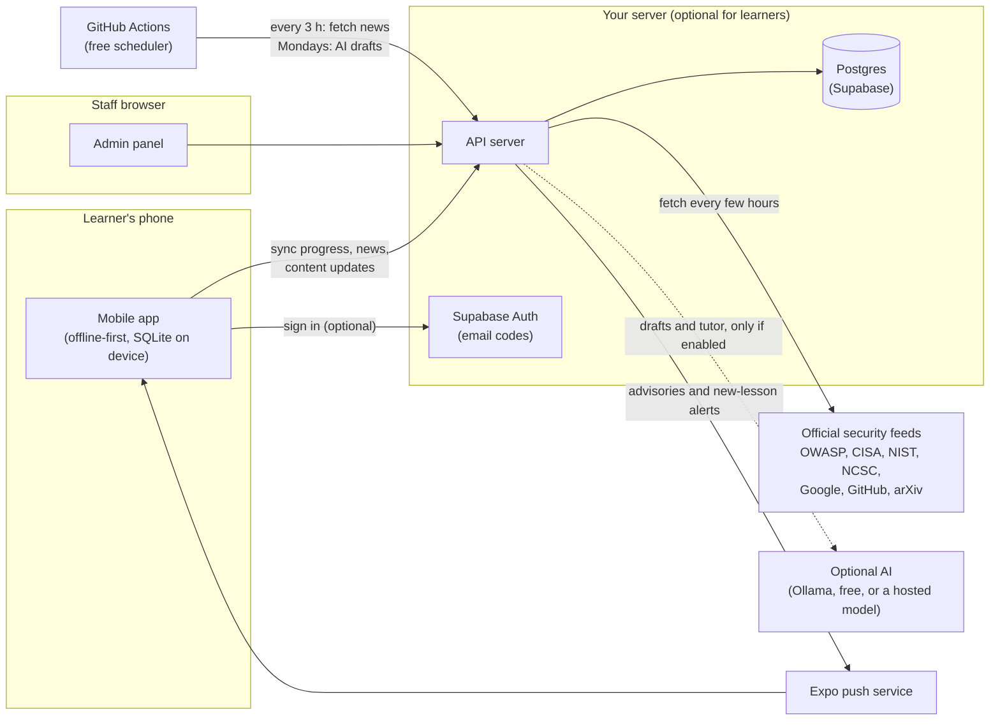
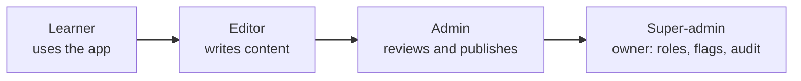
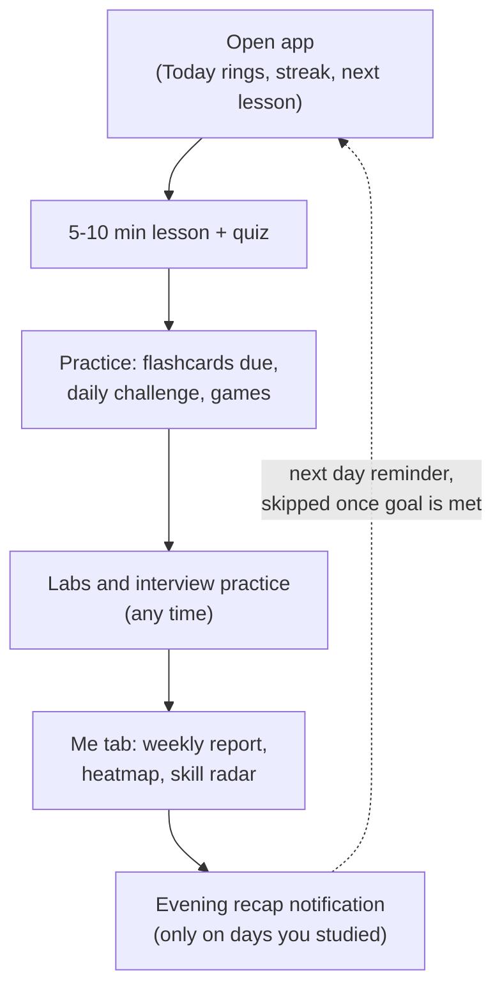
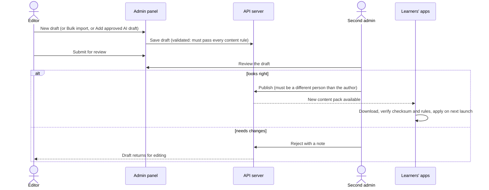
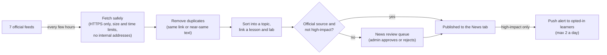
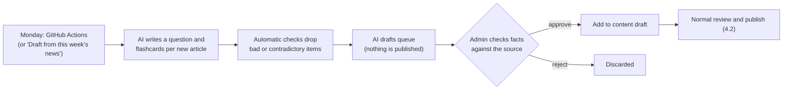
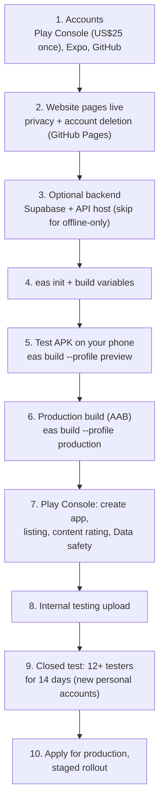

# Owner's guide: run, manage and publish the app

A plain-language guide for running **Learn AI & Agent Security** (store name *AI Agent Security*):
what the pieces are, how to start them on your laptop, who can do what, the weekly routine, and how
to get the app onto Google Play. Diagrams render directly on GitHub.

**Contents:** [1. The big picture](#1-the-big-picture) · [2. Start everything locally](#2-start-everything-locally) ·
[3. Roles](#3-roles-who-can-do-what) · [4. How things flow](#4-how-things-flow) ·
[5. Admin and super-admin checklists](#5-admin-and-super-admin-checklists) ·
[6. Publish on Google Play](#6-publish-on-google-play) · [7. Troubleshooting](#7-troubleshooting) ·
[8. Where to find more](#8-where-to-find-more)

---

## 1. The big picture

The project has three apps and two shared packages, all in this one repository.

| Part | What it is | Who uses it | Folder |
|---|---|---|---|
| **Mobile app** | The Android app learners install. Works fully offline. | Learners | `apps/mobile` |
| **Admin panel** | A website for staff: content, news review, users, analytics | Editors, admins, super-admin | `apps/admin` |
| **API server** | The backend: accounts, sync, news, content publishing, optional AI | Called by the app and admin panel | `apps/api` |
| Shared logic | XP, streaks, scoring, validation, tutor search | All three | `packages/shared` |
| Content | Lessons, flashcards, labs, games, interview questions | Bundled into the app | `packages/content` |

**Key idea:** the app works on its own. Lessons, quizzes, labs, games, interview practice, the tutor
(lesson answers) and progress reports all run on the phone with no internet. The server adds
optional extras: account backup and sync across devices, the live news feed, push alerts,
over-the-air content updates and the admin panel.

---

## 2. Start everything locally

**Needs:** Node.js 22 and this repository. No accounts, no database install: in local mode the API uses
an embedded database and a "developer sign-in" that sends no emails.

Run each command in its own terminal, from the repository root (the first time, run `npm install`):

| What | Command | Open |
|---|---|---|
| API server | `npm run api` | http://localhost:4000/health (API docs: http://localhost:4000/docs) |
| Admin panel | `npm run admin` | http://localhost:5173 |
| Mobile app in the browser | `npm run mobile` then press `w` | http://localhost:8081 |
| Mobile app on a phone | `npm run mobile` and scan the QR code with **Expo Go** | needs phone and laptop on the same Wi-Fi, with Node allowed through the firewall |

**Signing in locally:**
- **Admin panel:** type any email (for example `you@example.test`), pick a role (editor, admin, super_admin) and
  click *Sign in (developer mode)*. Try different roles to see what each can do.
- **Mobile app:** Settings → Account → any email; developer mode signs you straight in.

> Local data lives in `apps/api/.data/pglite` (`npm run api`) or in memory (the preview launch
> configuration), so you can reset it freely. Developer sign-in is switched off automatically in production.

**Optional local AI:** install [Ollama](https://ollama.com), run `ollama pull llama3.2`, then start the API with
`AI_PROVIDER=ollama AI_MODEL=llama3.2` and switch on the `ai` flag in the admin panel (Feature flags).

---

## 3. Roles: who can do what

Each role can do everything the roles to its left can, plus its own column below.

| Task | Learner | Editor | Admin | Super-admin |
|---|:-:|:-:|:-:|:-:|
| Use the app, sync, export or delete own data | ✅ | ✅ | ✅ | ✅ |
| Create and edit content drafts, bulk import, AI quiz drafts | | ✅ | ✅ | ✅ |
| Submit a draft for review | | ✅ | ✅ | ✅ |
| **Publish** content to all apps (four-eyes: not your own draft) | | | ✅ | ✅ (own drafts too) |
| Approve or reject AI drafts (not ones you requested) | | | ✅ | ✅ |
| Review news, manage news sources, run jobs now | | | ✅ | ✅ |
| Dashboard and Engagement analytics | | | ✅ | ✅ |
| Make someone a learner or editor | | | ✅ | ✅ |
| Make someone an **admin or super-admin** (or remove it) | | | | ✅ |
| Switch **feature flags** (AI, push, news, analytics…) | | | view | ✅ |
| **Audit log**, user CSV export | | | | ✅ |

Safety rules built in: nobody can change their own role; every admin action is written to an
append-only audit log; a second person must publish what an editor wrote ("four-eyes").

**Becoming the first super-admin:** put your email in the API setting `SUPER_ADMIN_EMAILS`. The first time
you sign in with that email, you become super-admin. Promote everyone else from **Users & roles**.

### Admin panel map

| Menu | Minimum role | Use it to… |
|---|---|---|
| Dashboard | Admin | See learners, news waiting, failing feeds, published content at a glance |
| Engagement | Admin | Active learners, retention, completion and drop-off (opt-in, groups of 5+ only) |
| Content | Editor | Create drafts, edit lessons, bulk import, submit, publish |
| AI drafts | Editor | Review AI-generated questions and flashcards, add approved ones to a draft |
| News review | Admin | Approve or reject flagged news items |
| Sources & ingestion | Admin | Turn feeds on or off, add feeds, fetch now, see failures |
| Users & roles | Admin | Find users, change roles |
| Audit log | Super-admin | Who did what, when |
| Feature flags | Admin (view), super-admin (change) | Turn whole features on or off without a new release |

---

## 4. How things flow

### 4.1 A learner's day

Signing in is optional. Without it, everything stays on the phone. With it, progress is backed up and
synced across devices, and the learner can export or delete everything from Settings → Account.

### 4.2 Publishing content (four-eyes)

Apps never apply a pack that fails validation or does not match its checksum; they keep the content
they already have. No Play Store update is needed for content changes.

### 4.3 Security news

### 4.4 Weekly AI drafts (optional)

### 4.5 Notifications

| Notification | Where it comes from | Rule |
|---|---|---|
| Daily reminder | Planned on the phone | Once a day, skipped when today's goal is met, never in quiet hours |
| Evening recap | Planned on the phone | Only on days with activity |
| Weekly report | Planned on the phone | Sundays |
| Security advisory | Server push (opt-in, signed in) | High-impact news an admin approved; max 2 a day |
| New lessons | Server push (opt-in, signed in) | When content is published; max 1 a day |

---

## 5. Admin and super-admin checklists

### One-time setup (super-admin)
- [ ] Set `SUPER_ADMIN_EMAILS` on the API and sign in once to become super-admin.
- [ ] Promote at least one other admin (four-eyes publishing needs two people, unless you publish as super-admin).
- [ ] Check **Feature flags**: `news`, `news_ingestion`, `sync` on; `ai`, `push`, `analytics`, `weekly_drafts` as you decide.
- [ ] Set `LEGAL.contactEmail` in `packages/content/src/legal.ts` and publish the website (section 6).
- [ ] Optional: GitHub secrets `API_URL` and `JOB_TOKEN` for the free scheduler ([content-operations.md](content-operations.md)).

### Weekly (about 10 minutes)
- [ ] **News review:** approve or reject flagged items.
- [ ] **AI drafts:** check each against its source link; approve the accurate ones, then *Add to content draft*.
- [ ] **Content:** open the draft, confirm validation is green, submit; a second admin publishes.
- [ ] **Sources & ingestion:** any feed failing repeatedly? Turn it off or fix it.

### Monthly
- [ ] **Engagement:** look at retention and roadmap drop-off; improve the lessons where people stop.
- [ ] **Audit log** (super-admin): look for unexpected role changes or publishes.
- [ ] **Users & roles:** remove roles from people who no longer need them.
- [ ] Back up the database (see [backend.md](backend.md) → Backups) and test a restore every few months.

---

## 6. Publish on Google Play

| Step | What to do | Done for you in the repo |
|---|---|---|
| 1 | Create a Google Play developer account, a free Expo account, a GitHub account | – |
| 2 | Repo Settings → Pages → Source: *GitHub Actions*; set the contact email | Pages workflow, privacy and deletion pages (`npm run site`) |
| 3 | Optional: Supabase project and an API host ([backend.md](backend.md)) | API, Dockerfile, production safety checks |
| 4 | `cd apps/mobile`, `npx eas-cli@latest login`, `npx eas-cli@latest init`, then set build variables | Build profiles in `eas.json` |
| 5 | `npx eas-cli@latest build -p android --profile preview`, install the APK, test everything | – |
| 6 | `npx eas-cli@latest build -p android --profile production` | Version auto-increments |
| 7 | Fill the listing and forms | Texts, icon, feature graphic, screenshots, Data safety answers in [docs/play-store](play-store/) |
| 8–10 | Upload, test with 12+ people for 14 days, apply, roll out | Submit profiles for internal and closed tracks |

**Without a backend** (offline-only first release): skip step 3 and don't set the API variables. The app
runs fully offline; sign-in, sync, news and push simply don't appear. You can add the backend later with
an app update.

Full detail: [release.md](release.md) · listing texts: [play-store/listing.md](play-store/listing.md) ·
Data safety answers: [play-store/data-safety.md](play-store/data-safety.md).

**Decide before the first upload (permanent):** the app id `com.vinoth.aiagentsecurity` in `apps/mobile/app.json`.

---

## 7. Troubleshooting

| Problem | Fix |
|---|---|
| Phone can't load the app in Expo Go | Phone and laptop on the same Wi-Fi; mark the Wi-Fi as Private in Windows and allow Node.js through the firewall |
| `npx` "running scripts is disabled" in PowerShell | Use `npx.cmd` instead of `npx` |
| `EADDRINUSE` when starting the API | Something already uses port 4000; stop the old API window |
| News stays empty locally | The API needs internet; behind a company proxy, set `HTTPS_PROXY` before `npm run api` |
| Can't publish my own draft | Four-eyes rule: ask another admin, or publish as super-admin |
| A draft won't submit | Open it: the validation panel lists exactly what to fix |
| App didn't show new content | Content applies on the **next launch** after download; close and reopen the app |
| AI features missing | Set `AI_PROVIDER` on the API and switch on the `ai` flag |

---

## 8. Where to find more

| Topic | Document |
|---|---|
| What was built in each phase | [phases.md](phases.md) |
| Weekly content routine, bulk import, free AI | [content-operations.md](content-operations.md) |
| Backend setup, environment variables, API endpoints | [backend.md](backend.md) |
| Security review and accepted risks | [security.md](security.md) |
| Performance measurements | [performance.md](performance.md) |
| Release steps in detail | [release.md](release.md) |
| Product specification | [../MASTER_PROMPT.md](../MASTER_PROMPT.md) |
