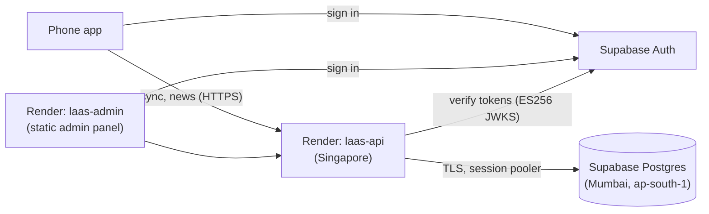

# Going live: Supabase + Render

How the production backend is set up for **Learn AI & Agent Security**. Supabase holds the data and
sign-in; Render runs the API server and the admin panel. Everything below is on free tiers.



## 1. Supabase (done)

Project **Learn AI and Agent Security** (`ixyhgyynfphoygzxttja`, Mumbai):

| Item | State |
|---|---|
| Schema | Migrations 001–008 applied and recorded in `schema_migrations`, so the API skips them on start |
| Row-level security | On for all 16 tables, no policies: the public REST API returns nothing even with the app key (verified). Only the API server, as table owner, reads and writes |
| Token signing | ES256 keys (JWKS); the API verifies them, no JWT secret needed |
| Project URL | `https://ixyhgyynfphoygzxttja.supabase.co` |
| Publishable key | `sb_publishable_…` (public by design, used by the app and admin panel) |

New migrations are applied by the API on start-up. To apply them by hand instead,
`npx tsx scripts/dump-migrations.ts out.json` (in `apps/api`) prints the exact SQL.

### Sign-in emails (action needed before real users)

Supabase's built-in email sender **only delivers to members of your Supabase organisation** and has a
low hourly limit; it's for testing. Before launch, either:
- connect a custom SMTP service (Authentication → Emails → SMTP settings), e.g. Brevo, Resend, AWS SES,
  Postmark or ZeptoMail, then raise the rate limit (Authentication → Rate limits); or
- rely on **Google sign-in** (planned), which needs no email.

Also check **Authentication → Emails → Magic link** contains `{{ .Token }}`: the app asks for the 6-digit code.

## 2. Render (one-time, about 15 minutes)

1. Sign in at https://render.com with GitHub and allow access to `learn-ai-agent-security`.
2. **New → Blueprint** → choose the repository. Render reads `render.yaml` and proposes two services:
   **laas-api** and **laas-admin**.
3. Fill in the values it asks for:

| Variable | Service | Value |
|---|---|---|
| `DATABASE_URL` | laas-api | Supabase → **Connect** → **Session pooler** string (port 5432), with your database password. No `?sslmode=` at the end |
| `SUPABASE_SERVICE_ROLE_KEY` | laas-api | Supabase → Project Settings → API Keys → **secret** key |
| `SUPER_ADMIN_EMAILS` | laas-api | your email |
| `CORS_ORIGINS` | laas-api | `https://laas-admin.onrender.com` (adjust if Render gives a different name) |
| `VITE_API_URL` | laas-admin | `https://laas-api.onrender.com` (adjust likewise) |

4. **Apply**. The first build takes a few minutes. Check `https://laas-api.onrender.com/ready` → `{"status":"ready"}`.
5. Open the admin panel, sign in with your email code (you are a team member, so it arrives), and you
   become super-admin.

**Free tier behaviour:** the API sleeps after about 15 minutes without requests; the next request
waits roughly a minute while it wakes. Fine for testing; use a paid instance once learners rely on it.
`ANALYTICS_SALT` and `JOB_TOKEN` are generated by Render; copy `JOB_TOKEN` into the GitHub secret
of the same name (with `API_URL`) to enable the scheduled content jobs.

**Stronger TLS (optional):** download the CA certificate from Supabase → Database settings → SSL
configuration, set `DATABASE_CA_CERT` to its contents and `DATABASE_SSL=verify`.

## 3. Point the app at the live backend

Set the build variables for the **production** (and **preview**) EAS environment, then build:

```
EXPO_PUBLIC_API_URL=https://laas-api.onrender.com
EXPO_PUBLIC_AUTH_MODE=supabase
EXPO_PUBLIC_SUPABASE_URL=https://ixyhgyynfphoygzxttja.supabase.co
EXPO_PUBLIC_SUPABASE_ANON_KEY=<publishable key>
```

Before releasing that build on Play, update **Data safety** (accounts, synced progress) as described in
[play-store/data-safety.md](play-store/data-safety.md).
