# Build history, phase by phase

What each phase delivered, where it lives in the code and how it was verified. The plan comes from
[MASTER_PROMPT.md §21](../MASTER_PROMPT.md). Phases 0–12 and the content operations work are done;
**Phase 13 (Pro access and community) is on hold.**

```mermaid
flowchart LR
  P0["0-1<br/>Setup +<br/>offline MVP"] --> P2["2<br/>Learning<br/>depth"] --> P3["3<br/>Labs"] --> P4["4<br/>Interview<br/>prep"] --> P5["5<br/>Backend,<br/>auth, sync"] --> P6["6<br/>News"] --> P7["7<br/>Admin +<br/>CMS"]
  P7 --> P8["8<br/>Notifications"] --> P9["9<br/>Analytics"] --> P10["10<br/>Optional AI"] --> P11["11<br/>Hardening"] --> P12["12<br/>Play release<br/>prep"] --> CO["Content<br/>operations"] -.-> P13["13<br/>Pro + community<br/>(on hold)"]
```

| Phase | Commit | Delivered | Main code | Verified by |
|---|---|---|---|---|
| **0–1 Setup and offline MVP** | `6297f56` | npm-workspaces monorepo, CI; the Expo app with onboarding, five themes and six accents, roadmaps, lesson player, quizzes, XP, levels and streaks, active-time tracking, Today rings, weekly chart, insights, local daily reminder | `apps/mobile`, `packages/shared`, `packages/content` | Unit tests; runs fully offline |
| **2 Learning depth** | `b2363ab` | FSRS spaced-repetition flashcards, mastery model and weak topics, 7 mini-games, deterministic daily challenge, streak freezes, badges, 26-week heatmap, skill radar, mastery trend, time-of-day analysis, shareable weekly report image | `shared/src/fsrs.ts`, `mastery.ts`, `badges.ts`; `mobile/src/components/games.tsx`, `reportCharts.tsx` | Unit tests; Maestro flows |
| **3 Security labs** | `fb074d2` | Data-driven simulation engine, 10 labs on fictional systems (attack → defend → report), interactive architecture diagrams, 0–3 stars, OWASP-style severity, PDF report export | `shared/src/labs.ts`, `content/src/labs/`, `mobile/src/app/lab/[id].tsx` | `labIssues()` rules for every lab; escaping tests for reports |
| **4 Interview prep** | `0b6d743` | Question bank, 7 role plans with auto-ticking weekly tasks, transparent rubric scoring, self-rating, bookmarks, timed 10/20/30-minute mock interviews with scorecards | `shared/src/interview.ts`, `content/src/interview/`, `mobile/src/app/interview/` | Every model answer must score ≥ 80% on its own rubric; vague answers ≤ 40% |
| **5 Backend, auth, sync** | `2ef674a` | Fastify API with Postgres (PGlite locally), Supabase email-code sign-in, server-side roles, append-only audit log, offline-first sync with merge rules, data export and account deletion, OpenAPI docs | `apps/api`, `shared/src/sync.ts`, `mobile/src/sync/` | Role test matrix; two-device sync tested in browsers |
| **6 News ingestion** | `7b1b3e7` | 7 verified official feeds, HTTPS-only bounded fetching, safe XML parsing, domain allow-lists, duplicate detection, topic classification, admin review queue, News tab with offline cache | `api/src/news/`, `mobile/src/app/(tabs)/news.tsx` | Tests with real feed samples; live ingestion |
| **7 Admin panel and CMS** | `2d947ee` | Web admin panel (dashboard, content editor with live validation, four-eyes publishing, news review, sources, users and roles, audit log, feature flags); over-the-air content packs | `apps/admin`, `api/src/routes/content.ts`, `mobile/src/state/contentUpdates.tsx` | API tests; editor → publish → app update tested end to end |
| **8 Notifications** | `4c8e38d` | Local planner (reminder skipped once the goal is met, recap only on active days, Sunday report, quiet hours); opt-in server push for advisories and new lessons with dedupe and daily caps | `shared/src/notifications.ts`, `mobile/src/state/notifications.tsx`, `api/src/push.ts` | Planner and push tests (no duplicate sends, quiet hours honoured) |
| **9 Analytics** | `15e44bc` | Opt-in, pseudonymous engagement events; active learners, minutes, completion, retention cohorts, roadmap drop-off, push tap rate, content freshness; groups under 5 hidden; admin Engagement page | `shared/src/analytics.ts`, `api/src/analytics.ts`, `admin/src/pages/Analytics.tsx` | Metrics checked against a seeded dataset |
| **10 Optional AI** | `156f66f` | Provider adapter (none, Anthropic, OpenAI-compatible, Ollama), daily token budget, per-user caps, caching, timeouts and fallbacks; Ask-the-tutor (works offline from lessons), AI interview feedback, AI quiz and news-summary drafts with four-eyes review | `api/src/ai/`, `shared/src/tutor.ts`, `mobile/src/app/tutor.tsx` | Full test suite with AI off; fake-provider tests for every fallback |
| **11 Hardening** | `f5e7f4f`, `6a3a2bc` | SSRF protection for feeds, https-only external links, admin content security policy, CI security job (dependency audit, secret scan), coverage floors, WCAG contrast test, 48dp touch targets, Android app shortcuts, home-screen widget, 7× faster sync, 31% smaller app bundle | `api/src/net.ts`, `mobile/plugins/`, `mobile/src/widget/` | [security.md](security.md), [performance.md](performance.md) |
| **12 Play release prep** | `51575a9` | Build profiles, release-safety guards, branded icon set, privacy policy and deletion pages (in-app and GitHub Pages), store listing, Data safety answers, graphics and screenshots, release guide | `apps/mobile/eas.json`, `content/src/legal.ts`, `docs/play-store/`, `docs/release.md` | Expo prebuild of config plugins; generated store assets |
| **Content operations** | `e85ddef`, `c3d3bbb`, `84e5635` | 22 new lessons (35 total), 140 flashcards, 70 interview questions; bulk import; weekly AI drafts from news; one-click add of approved drafts; free GitHub Actions scheduler; live test with local Ollama (and fixes it found) | `content/src/lessons/*2.ts`, `shared/src/contentOps.ts`, `api/src/jobs.ts` | Content rules; job and import tests; live run with real feeds and llama3.2 |
| **13 Pro and community** | – | On hold: Pro subscription through Google Play Billing, community where only Pro members post and reply | – | – |

## Today's inventory

| Item | Count |
|---|---|
| Roadmaps | 6 (A–F) |
| Lessons | 35 |
| Flashcards | 140 |
| Labs | 10 |
| Mini-games | 7 |
| Interview questions | 70 |
| Role plans | 7 |
| Automated tests | about 210 (shared logic 93, API 82, mobile 28, content 5, admin 1) |

Every lesson is marked *needs review*: the content was written with AI assistance and should be checked
by a subject-matter expert before you call it reviewed.
